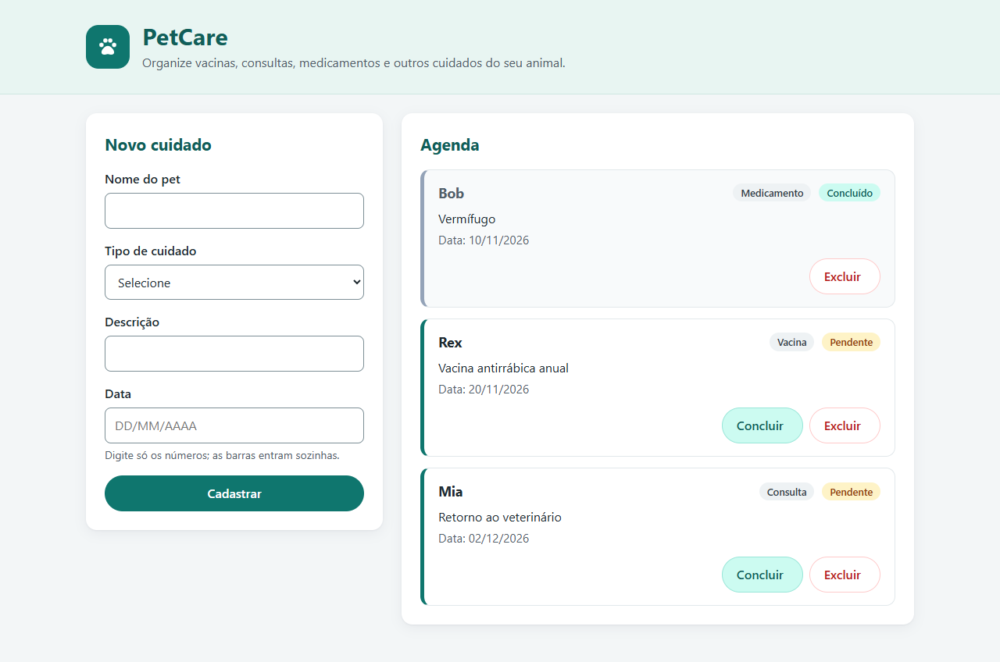

# PetCare

O PetCare é uma aplicação web para organizar os cuidados com animais de estimação, como vacinas, consultas e medicamentos. A ideia é ter num só lugar a agenda do pet, com o que já foi feito e o que ainda está pendente.

O projeto foi desenvolvido para a disciplina de Qualidade de Software da Universidade Católica de Brasília. A primeira versão serviu de base para a avaliação inicial de qualidade e, nesta segunda etapa, o sistema está recebendo melhorias acompanhadas de testes automatizados e integração contínua.

## Funcionalidades

Na página inicial há um formulário para cadastrar um cuidado, informando o nome do pet, o tipo de cuidado, uma descrição e a data no formato DD/MM/AAAA. O tipo pode ser escolhido na lista (vacina, consulta ou medicamento) ou, pela opção "Adicionar outro tipo…", digitado à mão, como "Banho e tosa", com até 50 caracteres.

Os dados são conferidos no servidor antes de serem gravados. O nome do pet (até 100 caracteres) e a descrição (até 500) são obrigatórios e não podem ficar só com espaços, o tipo precisa ser um dos três da lista ou, se for digitado, não pode ficar vazio, e a data precisa existir e não pode ser anterior a hoje. Se algo estiver errado, a página mostra o que precisa ser corrigido, mantém o que já foi digitado e não grava nada.

Logo abaixo fica a agenda, com os cuidados ordenados por data. Todo cuidado novo entra como pendente e pode ser marcado como concluído, editado ou excluído. Antes de excluir, o navegador pede uma confirmação; se você cancelar, nada é apagado. Os dados ficam salvos em um banco SQLite local, o arquivo `petcare.db`.

Ao clicar em "Editar", o formulário passa a se chamar "Editar cuidado" e já vem preenchido com o nome do pet, o tipo, a descrição e a data. As regras são as mesmas do cadastro, com uma diferença: se o cuidado já tem uma data que passou, ela pode ser mantida, para que cuidados antigos possam ser corrigidos, mas não dá para trocar por outra data passada. O status não muda ao editar, e "Cancelar" volta para a agenda sem salvar nada.

Todos os formulários que alteram dados (cadastro, edição, conclusão e exclusão) usam POST e são protegidos contra CSRF com o Flask-WTF. Um pedido que chegue sem o token do formulário, ou com um token inválido, é recusado com uma mensagem e um link de volta para a agenda.

Em cima da agenda dá para pesquisar pelo nome do pet, pelo tipo ou pela descrição, mostrar só os pendentes ou só os concluídos e escolher se as datas mais antigas ou as mais recentes aparecem primeiro. Os filtros ficam no endereço da página, então continuam valendo ao recarregar e depois de concluir, editar, excluir ou cadastrar um cuidado.

No computador, o formulário e a agenda ficam lado a lado; no celular, um embaixo do outro. Cada cuidado aparece num card com o tipo e o status, e os concluídos ficam acinzentados para se destacarem dos pendentes. Os campos têm rótulos associados e a página pode ser usada só com o teclado.



## Tecnologias

O back-end é feito em Python com Flask, a página usa templates HTML com Jinja2 e os dados ficam em SQLite. Para a parte de qualidade, o projeto usa pytest e pytest-cov nos testes, Ruff na análise estática e GitHub Actions na integração contínua. O projeto foi testado com Python 3.14.

## Como executar

Com o Python instalado, dentro da pasta do projeto, instale as dependências:

```bash
pip install -r requirements.txt
```

As versões estão fixadas no `requirements.txt`, para que a instalação seja igual em qualquer máquina. Se preferir, crie antes um ambiente virtual com `python -m venv venv`, pois a pasta `venv/` já está no `.gitignore`.

Depois, inicie a aplicação:

```bash
python app.py
```

Ao iniciar, a tabela de cuidados é criada no `petcare.db` caso ainda não exista. Com o servidor rodando, é só abrir http://127.0.0.1:5000 no navegador. É o servidor de desenvolvimento do Flask, então não deve ser usado em produção.

O modo debug vem desligado. Para ligá-lo durante o desenvolvimento, defina `PETCARE_DEBUG=1` antes de iniciar (no PowerShell, `$env:PETCARE_DEBUG = "1"`). Qualquer outro valor, ou a variável ausente, mantém o debug desligado.

A proteção CSRF depende de uma chave secreta, lida da variável de ambiente `PETCARE_SECRET_KEY`. Se ela não estiver definida, o aplicativo gera uma chave aleatória a cada vez que é iniciado. Isso funciona para uso local, mas uma página que estava aberta antes de reiniciar o servidor precisa ser recarregada antes de enviar um formulário. Para manter a mesma chave, defina a variável antes de iniciar (no PowerShell, `$env:PETCARE_SECRET_KEY = "uma-chave-longa-e-aleatoria"`). A chave não deve ser colocada no repositório.

## Testes e análise estática

As ferramentas de desenvolvimento ficam em um arquivo separado, que já inclui as dependências da aplicação:

```bash
pip install -r requirements-dev.txt
```

Para rodar os testes:

```bash
pytest
```

Os testes ficam na pasta `tests/` e usam o cliente de testes do Flask. Cada teste cria um banco SQLite temporário, então rodar a suíte não altera o `petcare.db`. Para ver também a cobertura do `app.py`, use `pytest --cov`.

Para a análise estática:

```bash
ruff check .
```

As regras do Ruff e as configurações do pytest estão no `pyproject.toml`.

## Verificação automática

O workflow `.github/workflows/ci.yml` roda no GitHub Actions a cada push e a cada pull request. Ele instala as dependências de `requirements-dev.txt`, confere se não há conflitos entre elas, executa o Ruff e depois o pytest com o relatório de cobertura. Se alguma etapa falhar, a execução aparece como falha no commit ou no pull request.

## Estrutura do projeto

```
app.py                 aplicação Flask (rotas e acesso ao banco)
templates/index.html   página principal
static/style.css       estilos da página
petcare.db             banco SQLite
tests/                 testes automatizados
pyproject.toml         configuração do pytest, da cobertura e do Ruff
requirements.txt       dependências da aplicação
requirements-dev.txt   dependências de desenvolvimento
.github/workflows/     workflow de integração contínua
docs/interface/        capturas da interface (antes e depois da modernização e filtros)
```

## Qualidade de software

A avaliação inicial da Parte 1 está em [BASELINE.md](BASELINE.md), referente à versão `v1.0.0-baseline`. O plano da Parte 2, com os problemas escolhidos, os indicadores e as metas, está em [PLANO_MELHORIA_PARTE2.md](PLANO_MELHORIA_PARTE2.md). A seção 10.1 do plano lista cada ciclo de mudança com a issue, a branch e o pull request correspondentes.
